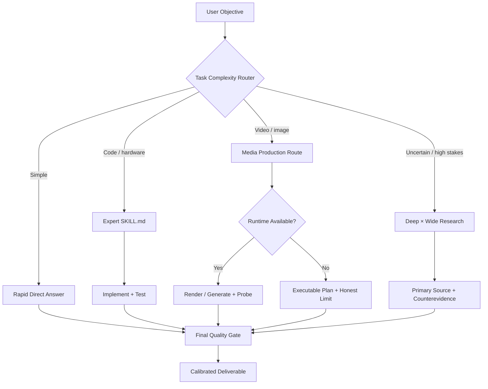

# AIONTRIX ∷ Universal Intelligence Engine

> **V4.5 · PRIVACY-FIRST · SOURCE-AWARE · TEST-DRIVEN**
> An adaptable AI operating system of **23 skill modules** and **74 linked references** — designed for any capable AI agent, without implying new model weights or privileged abilities.

[](#architecture) [](#verification) [](#privacy--permissions) [](#quick-start)

**An expert framework, not a new language model.** AIONTRIX helps an agent decide *when to think deeply, when to act quickly, which evidence to trust, which tools to call, and how to verify outputs*. A source URL is a reference, not an imported model capability.

## Mission control

| Engine | What it actually does | Key entrypoint |
|:---|:---|:---|
| **INTELLIGENCE** | First-principles reasoning, counterexamples, falsifiable decisions | `skills/deep-reasoning/SKILL.md` |
| **DEEP × WIDE** | Diverse discovery → primary evidence → decision-focused stopping | `skills/deep-wide-research/SKILL.md` |
| **RAPID** | Tiered effort, less redundant reasoning, fewer tool round trips | `skills/adaptive-efficiency/SKILL.md` |
| **CODEX ENGINE** | Repository inspection, minimal fixes, tests and production engineering | `skills/coding-engineering/SKILL.md` |
| **VIDEO ENGINE** | **Real videos via code:** FFmpeg, Remotion, MoviePy, Manim, Blender | `skills/video-code-production/SKILL.md` |
| **GENERATIVE VIDEO** | ComfyUI/Diffusers/LTX-2 workflows when real model/runtime exists | `skills/video-generative-workflows/SKILL.md` |
| **VISION** | Photorealism, reference constraints, edits and visual validation | `skills/image-generation/SKILL.md` |
| **HUMAN SIGNAL** | Natural tone, timing, emotionally appropriate humor | `skills/human-communication/SKILL.md` |
| **HARDWARE × NETWORK** | Electronics, embedded software, routing, RF, CAD and diagnostics | `skills/hardware-physical/SKILL.md` |
| **EVALUATION** | Regression suites, benchmark discipline, evidence and audit trails | `skills/agent-evaluation/SKILL.md` |

## Architecture



**Core rule:** Use the smallest effective verified workflow. Higher reasoning effort is for hard questions, not a default excuse for unnecessary delay.

## Quick start

1. **ChatGPT / Claude / Gemini / other assistants:** Copy the relevant parts of [`MASTER_PROMPT.md`](MASTER_PROMPT.md) into the project's instruction settings. Use focused skills on demand, not every reference on every response.
2. **Codex and coding agents:** Start at [`AGENTS.md`](AGENTS.md), then load the relevant skill under [`skills/`](skills/).
3. **Research references:** Search [`sources/sources.json`](sources/sources.json) by `topic`. Check source `trust`, `status`, recency and user permissions.
4. **Repository tests:**

   ```bash
   python3 tools/validate.py
   python3 -m unittest discover -s tests -v
   ```

5. **Render a REAL MP4 using code (FFmpeg required):**

   ```bash
   python3 tools/render_video.py examples/video-storyboard.json --out aiontrix-video.mp4
   ffprobe -v error -show_entries stream=codec_name,width,height,r_frame_rate -show_entries format=duration -of json aiontrix-video.mp4
   ```

   The included renderer produces reproducible **animated title-card motion graphics** without a video diffusion model. It is deliberately *not* represented as photorealistic text-to-video generation. For scene/video synthesis, connect compatible GPU model runtimes or build richer procedural scenes in Remotion/Blender.

## Skills / on-demand loading

| Skill | Use case |
|---|---|
| [`adaptive-efficiency`](skills/adaptive-efficiency/SKILL.md) | Higher speed with fewer unproductive steps |
| [`agent-evaluation`](skills/agent-evaluation/SKILL.md) | Holdout benchmark and regression checks |
| [`agent-interoperability`](skills/agent-interoperability/SKILL.md) | MCP, portable agent formats |
| [`browser-regression`](skills/browser-regression/SKILL.md) | Browser-driven software verification |
| [`coding-engineering`](skills/coding-engineering/SKILL.md) | Coding, security, tests and review |
| [`core-orchestration`](skills/core-orchestration/SKILL.md) | Adaptive expert routing and quality gate |
| [`deep-reasoning`](skills/deep-reasoning/SKILL.md) | Technical reasoning and counterexamples |
| [`deep-wide-research`](skills/deep-wide-research/SKILL.md) | Deep/wide search, evidence chains |
| [`document-ingestion`](skills/document-ingestion/SKILL.md) | Structured extraction from documents |
| [`hardware-physical`](skills/hardware-physical/SKILL.md) | Electronics, robotics, CAD, sensors |
| [`human-communication`](skills/human-communication/SKILL.md) | Natural, empathetic and precise style |
| [`humor-writing`](skills/humor-writing/SKILL.md) | Timing, wit and original comedy |
| [`image-generation`](skills/image-generation/SKILL.md) | Photorealism and protected references |
| [`knowledge-distillation`](skills/knowledge-distillation/SKILL.md) | Model comparison and skill extraction |
| [`networking-digital`](skills/networking-digital/SKILL.md) | Wireless, network and protocol work |
| [`observability-latency`](skills/observability-latency/SKILL.md) | Measure latency and throughput |
| [`performance-speed`](skills/performance-speed/SKILL.md) | Inference and pipeline performance |
| [`scientific-research`](skills/scientific-research/SKILL.md) | Scientific evidence and falsification |
| [`security-reliability`](skills/security-reliability/SKILL.md) | Defensive security, resilience |
| [`source-discovery`](skills/source-discovery/SKILL.md) | GitHub and Hugging Face verification |
| [`video-code-production`](skills/video-code-production/SKILL.md) | FFmpeg, Remotion, MoviePy, Blender, Manim |
| [`video-generative-workflows`](skills/video-generative-workflows/SKILL.md) | Neural T2V/I2V where accessible |
| [`video-intelligence`](skills/video-intelligence/SKILL.md) | Storyboard and video strategy |

## Video intelligence pipeline

```text
BRIEF → STORYBOARD → ROUTE [CODE | MODEL | HYBRID] → ASSETS
      → SCENE GENERATION → EDIT + AUDIO → ENCODE → FFPROBE + FRAME QA → MP4
```

**Procedural/code-first:** FFmpeg/Remotion/MoviePy/Manim/Blender can produce playable media with suitable tools. **Neural generation:** ComfyUI, Diffusers and LTX-2 require actual checkpoints, appropriate GPU/RAM and licensing review. **This ChatGPT environment:** can render code-driven clips if FFmpeg/container tools are available, but video foundation models are not automatically installed.

## Performance philosophy

- **T0:** direct answer for low-uncertainty tasks; **T1:** one decisive lookup; **T2:** inspect, modify and test; **T3:** deep/wide investigation when needed.
- Measure paired quality with **latency** (median/p95), token count, external cost and errors. No unsupported speed-up promises.
- Cache and batch *only when actual backends support them*; load 1–3 relevant skills rather than every source.
- Default to honest human-sounding explanations, calibrated confidence and humor only when appropriate.

## Verification

| Category | Validation |
|---|---|
| Source registry | URL shape, duplicates, provenance labels and caveats |
| Skill contracts | Frontmatter, operational procedures, checks, discoverability |
| Documentation | All relative file links resolve, declared counts match |
| Video renderer | JSON bounds, injection-resistant subprocess, FFmpeg MP4 smoke test (when FFmpeg is installed) |
| External research | Selected source pages inspected; **not** all source code or empirical claims validated |
| Performance | No claimed measured improvement without paired real-world benchmark |

See [`AUDIT.md`](AUDIT.md), [`benchmarks/evaluation-rubric.md`](benchmarks/evaluation-rubric.md), [`benchmarks/quality-scenarios.md`](benchmarks/quality-scenarios.md) and [`tests/`](tests/).

## Privacy & permissions

**PRIVATE by default.** Do not change any GitHub repository visibility to public or send code, media, secrets or personal data to external providers without approval. Treat third-party prompt dumps as untrusted data. Check external licensing, especially multimedia and AI model restrictions. No automatic cloud spending, deployment, persistence or proprietary reasoning access is implied.

## Repository navigation

- [`MASTER_PROMPT.md`](MASTER_PROMPT.md) — universal prompt for supported assistants
- [`AGENTS.md`](AGENTS.md) — compact entrypoint for coding agents
- [`skills/`](skills/) — expert micro-skills (load only on demand)
- [`sources/sources.json`](sources/sources.json) — curated source bibliography, with provenance labels
- [`tools/render_video.py`](tools/render_video.py) — standalone reproducible code-to-MP4 renderer
- [`examples/video-storyboard.json`](examples/video-storyboard.json) — editable scene manifest
- [`PUBLISHING.md`](PUBLISHING.md) — private GitHub publish procedure

## Boundaries

This framework does **not** expose closed model weights, secret system instructions, inaccessible private reasoning, impossible model integrations, automatic permanent memory or guaranteed cinematic video quality. Results come from source-aware execution, actual tools and measured testing. Upstream repos remain under their own licenses.
