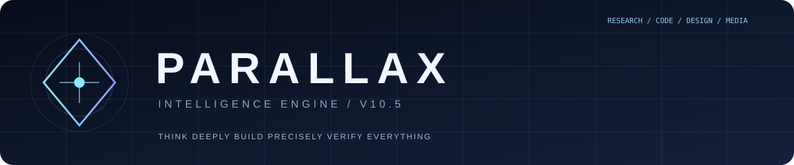

<div align="center">
  

  **Better methods. Sharper work. Evidence you can inspect.**

  `v11.2` · `142 specialist skills` · `157 linked references` · `Python 3.12+`
</div>

---

PARALLAX is a focused collection of methods, tools and independent checks for working with AI across engineering, research, creativity, design, images, video, audio and complex planning. It routes tasks to the right instructions, provides offline verification tools and keeps honest boundaries around what a model can *actually* do.

### Find your route

| Work | Start here |
|:--|:--|
| **Design & UI** | [Design direction](docs/DESIGN-DIRECTION.md) · [Taste](skills/design-taste-direction/SKILL.md) · [Image to code](skills/image-to-code-fidelity/SKILL.md) |
| **Code & systems** | [Engineering](skills/coding-engineering/SKILL.md) · [Planning](skills/planning-orchestration/SKILL.md) · [Tests](skills/software-contract-testing/SKILL.md) |
| **Research & ideas** | [Deep research](skills/deep-wide-research/SKILL.md) · [Creative discovery](skills/creative-discovery/SKILL.md) |
| **Image / video / sound** | [Image](skills/image-generation/SKILL.md) · [Video](skills/video-intelligence/SKILL.md) · [Audio](skills/audio-speech-engineering/SKILL.md) |
| **TikTok-discovered** | [Source → GitHub methods](docs/TIKTOK-TO-GITHUB.md) · [Visual reference QA](skills/visual-evidence-qa/SKILL.md) |
| **DeepSeek Free** | [Web-only execution ladder](docs/DEEPSEEK-WEB-ONLY.md) |
| **Freshness & continuity** | [When to refresh](docs/REPOSITORY-REFRESH.md) · [Project log](docs/CONTINUITY.md) |


### New in v11

Image Intelligence now treats references, protected identity and compositing as distinct steps. **Most tasks do not need a render.** Five methods traced through indexed TikTok posts are documented with their original GitHub sources; no third-party code is silently installed. Every pre-existing skill has three targeted safeguards. [Browse 150 scoped capability contracts](docs/CAPABILITY-ATLAS-150.md) — these are methods and acceptance criteria, not 150 running model integrations.

**Natural by default.** Keep verification inside the process; don't litter user-facing responses with `[ESTABLISHED]`, `[APPROVED]` or similar labels unless requested.

### DeepSeek Free — verification without a shell

[**GET-only test status →**](docs/DEEPSEEK-QUICKSTART.md) · [Small skills catalog](bridge/v1/index.json)

Tests run automatically on repo pushes, with an extra best-effort daily GitHub Actions suite. DeepSeek can read public results and verify the tested commit without tokens, but cannot submit new code or start a job through GET alone.

### Run the DeepSeek GET Python Lab

The fixed-case [Python Worker source](apps/deepseek-get-python-lab/README.md) is available in the repository. You can [open the Cloudflare deploy flow](https://deploy.workers.cloudflare.com/?url=https://github.com/Blurry-hash/parallax-intelligence-engine/tree/main/apps/deepseek-get-python-lab) using your own Cloudflare account. **No live Worker URL has been confirmed.** Deployment is owner-account gated; do not invent a \u0060lab_url\u0060 until a real endpoint passes HTTP checks.

### Use it in another AI

[**Universal activation prompt →**](docs/UNIVERSAL-ACTIVATION.md) — works as a starting instruction for ChatGPT, DeepSeek, Claude, Gemini and other assistants. It asks the model to inspect the live repository, use relevant skills and *request* persistent memory only if supported.

### Run the checks

```bash
python tools/validate.py
python -m unittest discover -s tests -q
python tools/design_contract.py examples/design-contract-v10.5.json
python tools/deepseek_get_probe.py '7*6'  # URL only, no false execution claims
python tools/freshness_gate.py --force  # read-only GitHub revision check
```

### Operating principles

**Small context, real evidence.** Originality, creativity and holdout comparisons matter more than inflated scores. Open only the skills you need. Verify artifacts and critical assumptions before declaring success. A linked project is not an installed tool; a GET math evaluator is not a Python sandbox; repository continuity is not your account memory.

**Public repository by owner choice.** Do not change visibility or write to other projects. External code, model providers and browser services need real access and permission.

<sub>[Agent entrypoint](AGENTS.md) · [Master Prompt](MASTER_PROMPT.md) · [Release notes](docs/CONTINUITY.md) · [Verification](AUDIT.md) · [Browse all skills](skills/)</sub>

<details><summary>All specialist skills</summary>

`acceptance-evidence-ledger` · `accessibility-assurance` · `action-audit-trail` · `adaptive-efficiency` · `agent-evaluation` · `agent-interoperability` · `agent-review-boundaries` · `algorithmic-complexity` · `api-contract-engineering` · `api-evolution-compatibility` · `artifact-delivery-gates` · `artifact-proof-chain` · `ast-safe-transformations` · `audio-provider-routing` · `audio-realtime-streaming` · `audio-speech-engineering` · `browser-compute-bridge` · `browser-regression` · `browser-wasm-sandbox` · `cache-invalidation-design` · `capability-contract` · `causal-inference` · `checkpoint-resume-reliability` · `code-synthesis-evaluation` · `coding-engineering` · `concept-laboratory` · `context-engineering` · `continuous-learning-memory` · `core-orchestration` · `cost-aware-architecture` · `creative-discovery` · `creative-quality-diversity` · `cross-model-activation` · `cross-platform-apps` · `data-quality-pipelines` · `database-query-planning` · `database-reliability` · `decision-systems` · `deep-reasoning` · `deep-wide-research` · `deepseek-web-only-lab` · `deliberate-work-sessions` · `dependency-graph-acceleration` · `design-system-engineering` · `design-system-provenance` · `design-taste-direction` · `differential-testing` · `document-ingestion` · `durable-automation` · `evolution-governance` · `experimental-verification` · `expressive-audio-production` · `fault-tolerant-distributed-systems` · `formal-assumption-register` · `formal-invariants` · `frontier-model-routing` · `graphics-render-pipeline` · `hardware-physical` · `human-communication` · `humor-writing` · `image-generation` · `image-to-code-fidelity` · `incremental-build-analysis` · `interface-design` · `interface-state-testing` · `knowledge-distillation` · `latency-budgeting` · `learning-curriculum` · `mission-release-review` · `model-routing-benchmarks` · `multimodal-evidence-alignment` · `multimodal-fusion` · `mutation-testing-strategy` · `networking-digital` · `observability-latency` · `originality-evaluation` · `paired-regression-gates` · `parallel-execution-correctness` · `performance-regression-detection` · `performance-speed` · `performance-validation` · `planning-orchestration` · `policy-authorization` · `privacy-by-design` · `property-based-testing-lab` · `public-repo-hygiene` · `remote-test-relay-design` · `repo-refresh-protocol` · `reproducible-environments` · `research-source-independence` · `resource-aware-scheduling` · `retrieval-quality` · `root-cause-debugging` · `runtime-memory-analysis` · `safe-code-agent-workflow` · `scientific-computation` · `scientific-research` · `security-reliability` · `self-evolution-engine` · `skill-context-compiler` · `skill-supply-chain` · `software-contract-testing` · `source-discovery` · `speech-quality-laboratory` · `streaming-backpressure` · `structured-output-reliability` · `subagent-review-protocol` · `symbolic-execution-planning` · `threat-modeling` · `type-directed-code-synthesis` · `ui-render-performance` · `video-audio-sync-lab` · `video-captions-accessibility` · `video-code-production` · `video-color-science` · `video-encoding-efficiency` · `video-generation-backends` · `video-generative-workflows` · `video-intelligence` · `video-media-provenance` · `video-qc-telemetry` · `video-render-budget` · `video-shot-grammar` · `video-storytelling-critique` · `video-temporal-consistency` · `video-timeline-engineering` · `visual-production-pipeline` · `visual-regression` · `voice-synthesis-architecture` · `web-interface-guideline-audit`

`comfyui-graph-integrity` · `context-mode-offloading` · `marketing-experiment-ops` · `n8n-workflow-import-audit` · `natural-response-contract` · `video-use-transcript-editing` · `visual-candidate-selection` · `visual-compositing-plan` · `visual-control-backend` · `visual-evidence-qa` · `visual-identity-drift` · `visual-intent-contract`

</details>
